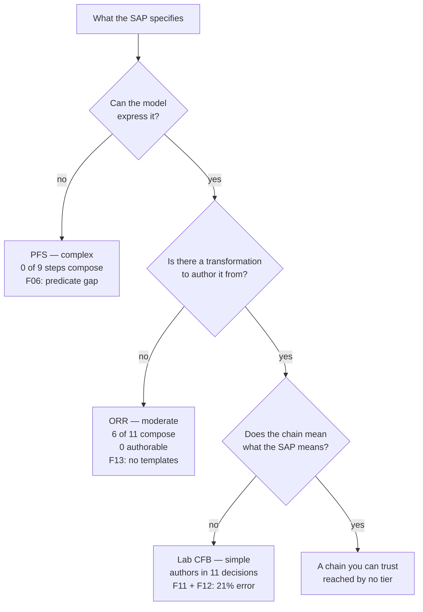

# usdm-acdc-in-practice

USDM v4.0 and the CDISC AC/DC framework — BC to DC to AC — applied end to end on a simulated Phase 3 oncology trial.

---

**Start with [`NORTH.md`](NORTH.md)** — the destination, the eight-stage finish line, and the
test any piece of work has to pass. Seven of nine stages are done.

## What this is

CDISC's [`cdisc-org/analysis-concepts`](https://github.com/cdisc-org/analysis-concepts) implements the AC/DC framework: an Observation / Derivation / Analysis Concept model, 60 methods, a transformation library, an eSAP model and a working browser-based builder with in-browser R execution.

This repository does not reimplement any of that. It takes three real endpoints of graded complexity through the full chain and records what the process actually costs — what is automated, what a human authors, and where it strains.

The source study is [TORIVA-LUNG 301](https://github.com/OpenTrialReporting/torivumab-nsclc-301), a simulated Phase 3 NSCLC trial with a fictional sponsor. It was chosen because it is the only available source where protocol, SAP, programming specs and built ADaM all exist, are internally consistent, and carry no confidentiality constraint. That last point matters: without built ADaM there is no ground truth, and without ground truth the exercise only demonstrates internal coherence.

## Findings

These came out of applying the framework, and are the most reusable part of this repository.
Each is written up in `docs/findings/`, with the commands and output that establish it.

Every finding was re-verified against the pinned upstream commit before being written up.
**Two of the five original findings did not survive that check, and one was retired outright** —
including one of the two that was slated to be filed as an upstream issue. See
[`docs/method.md`](docs/method.md) for why that step exists.

| ID | Claim | Status at `739344c` |
|---|---|---|
| [F01](docs/findings/F01-no-tte-derivation-transformations.md) | No time-to-event derivation transformations exist | **Confirmed in part** |
| [F02](docs/findings/F02-time-event-role-collision.md) | The `censoring` statistical role is declared and unused | **Corrected** |
| [F03](docs/findings/F03-chain-position-carries-meaning.md) | Chain position carries meaning that individual entries do not | **Confirmed, stronger** |
| [F04](docs/findings/F04-bc-joint.md) | The BC joint is annotated, not resolved | **Retired** |
| [F05](docs/findings/F05-no-analysis-coverage-view.md) | No study-level view exists | **Restated** |
| [F06](docs/findings/F06-no-general-predicate.md) | No general predicate exists over more than one variable | **New** |
| [F07](docs/findings/F07-ordering-is-unstated.md) | `best`/`worst` presuppose an ordering the metadata does not carry | **New, amended** |
| [F08](docs/findings/F08-no-risk-difference.md) | No difference-of-proportions statistic exists | **New** |
| [F09](docs/findings/F09-record-selection-has-no-tiebreak.md) | Record selection carries no tie-break and cannot express a composite sort key | **New, corrected twice** |
| [F10](docs/findings/F10-visit-windows-are-enumerated-not-generated.md) | Visit windows must be enumerated, and nothing may escape windowing | **New** |
| [F11](docs/findings/F11-analysis-record-flag-has-no-transformation.md) | The model names `ANL01FL` and nothing produces it | **New** |
| [F12](docs/findings/F12-baseline-flag-and-baseline-value-are-disconnected.md) | The baseline flag and the baseline value are disconnected | **New** |
| [F13](docs/findings/F13-authoring-surface-is-narrower-than-the-model.md) | The authoring surface is far narrower than the model | **New** |

**F01 — No time-to-event derivation transformations exist.** *Confirmed in part.* The strings
`CNSR`, `censor` and `AVAL` appear nowhere in the transformation library, and `T.OS_LogRank`
binds time and event as inputs, so the survival chain begins already derived. But this
finding's second argument — that the model admits only one output per derivation — **was
false.** `M.UnitConversion` and `M.WindowedVisitAssignment` declare two and three coordinated
output classes, and `T.UnitConversion` emits `result.value` as a measure and `result.unit` as a
facet attribute of the same `Measure`. That is close to the shape a TTE derivation needs. The
gap is library content plus F06, and narrower than claimed.

**F02 — Time and event are indistinguishable in method metadata.** *The premise was wrong.*
There is no `censoring` value in `StatisticalRole` and there never has been — `git log -S`
over the schema returns nothing. The role actually declared and unused is `offset`. The
consequence stands and is the part that matters: `M.KaplanMeier`, `M.CoxPH` and `M.LogRankTest`
each declare `time` and `event` as two `response` roles, so any signature over input roles
treats them as interchangeable.

**F03 — Chain position carries meaning that individual entries do not.** Confirmed, and stronger
than stated. `T.ADAS_SumAvailableScores` and `T.ADAS_MissingScaleCapacity` differ in exactly one
field: the free-text `note` on an input binding. Every machine-readable field is identical, so no
signature over structured fields can separate them.

**F04 — The BC joint is annotated, not resolved.** *Retired.* In the worked derivation scenario
all five `Measure` terminals carry 11 `linkedBCIds` each. The four terminals without links are
dimensions — Subject, Parameter, Treatment, Visit — which have no BC to link to. The endpoint-level
`linkedBCIds` is empty, which is where the original reading came from; linkage lives at terminal
level, which is the right place for it.

**F05 — No analysis-coverage view exists.** *Restated.* `js/views/study-overview.js` does exist and
does show objectives and endpoints. What it carries is a checkbox per endpoint, feeding endpoint
selection into the eSAP builder. It holds no authoring state: no chain status, no shared
derivations, no coverage. The gap is narrower than claimed and sharper.

**F06 — No general predicate exists over more than one variable.** *New, and it blocks the complex
tier.* `M.ConditionalValue` is not a general conditional — its predicate is hardwired to
`IF(IS_NA(value), alternate, base)`. `M.ThresholdCompare` compares one input to a constant.
`M.Categorization` takes free-text conditions over a single `value` input. So the specification's
hypothesis that the FDA 2018 censoring hierarchy composes as nested `M.ConditionalValue` over
`M.RecordSelection` is **false on paper**, before any authoring. Confirmed independently on ORR,
whose confirmation rule is a two-record predicate — so this is a general derivation gap, not a
time-to-event one.

**F07 — `best` and `worst` presuppose an ordering the metadata does not carry.** *New, amended.*
`M.RecordSelection.selection_rule` offers `best`, and nothing says what best means — not for a
decimal (maximum or minimum?) and not at all for an ordinal code like RECIST response
(CR ≺ PR ≺ SD ≺ PD ≺ NE). Best overall response composes syntactically while the semantics that
make it correct sit outside the model. **The lab tier then contradicted this finding's own
proposed fix**: TORIVA's shift table ranks `LOW = HIGH > NORMAL`, an ordering belonging to one
table rather than to the scale, so declaring the ordering on the concept would be authoritative
and wrong. Both concept-level declaration and per-use override are needed.

**F08 — No difference-of-proportions statistic exists.** *New.* TORIVA's ORR estimand specifies a
stratified Mantel–Haenszel **risk difference**. `M.CMH` yields an odds ratio, and the statistics
vocabulary carries no difference statistic at all. Under ICH E9(R1) the population-level summary
is part of the estimand, so substituting the odds ratio answers a different question.

**F09, F10, F11 — three gaps around selection and visit windowing.** *New, from the lab tier.*
`M.RecordSelection` orders by a single required `time_order` role that **no transformation in
the library binds** — the string appears in two method files and nowhere else in the repository
— and offers no tie-break, while `M.CoxPH` and `M.Rounding` both declare tie enums (F09).
`M.WindowedVisitAssignment` takes an enumerated window array — it cannot express a window
*rule*, cannot express TORIVA's open-ended maintenance schedule, and gives event-driven visits
no escape from day-windowing (F10). And `M.RecordSelection`'s output description names
`ANL01FL` while nothing produces one; five of its six selection rules are used by nothing (F11).

F09 was **corrected twice on the day it was written** — first for calling the unbound roles a
conformance defect, then again when the app was actually served and two of its three UI claims
turned out to be wrong (`T.LOCF_Imputation` does bind an ordering, under the role name `order`
its method does not declare; and the derivation pipeline does have an add control). Only the
core capability claim survived. That makes five findings with a disproved premise or fix, three
of which failed by inferring application behaviour from library JSON.

**F13 — the authoring surface is far narrower than the model.** *New, from attempting to author
ORR, and it re-scores the ladder.* A chain is authored from **transformation templates**, not
methods. **39 of 60 methods (65%) have no template**; 8 of the 25 templates are ADAS-Cog
scaffolding, leaving **six generic derivation entries**; a shipped template's method
configuration cannot be edited anywhere in the builder; and no template can be created. The
ladder was scored against the method library — against the authoring surface, **PFS drops from
one composable step to zero**, because its one step needed `M.DateDifference`, which has no
entry.

**F12 — the baseline flag and the baseline value are disconnected.** *New, and the first
finding produced by running the builder rather than corrected by it.* `T.BaselineSelection`
outputs a `Flag`, and the pipeline matches derivations to dependencies by output concept
(`findDerivationsForConcept`, exact string equality), so it can never resolve the `Measure` that
`T.ChangeFromBaseline` needs — the builder offers LOCF imputation, seven ADAS-Cog helpers and a
unit conversion instead. `BASE` is reached only by constraining `AnalysisVisit` to `Baseline`,
making it a **visit-based** definition where SAP §12.3's is explicitly **date-based**; one line
of `adlb.R` is the entire bridge. Incidentally, because matching is by concept string, the
builder will offer the baseline record flag to resolve **the event indicator of a log-rank
test** — F02 arriving as an authoring hazard rather than a signature one.

**The upstream issues are parked** (`docs/findings/upstream-issues.md`). Five were drafted and
none filed; filing advances no stage of [`NORTH.md`](NORTH.md), so they are kept as a record
rather than carried as an obligation.

The findings themselves stay, because knowing where a framework's limits are is part of
understanding it. They are **by-products** — recorded when they blocked a stage, not pursued
for their own sake.

Worth keeping in view: **five findings had a premise or proposed fix disproved** — F01, F02,
F04, F07, F09 — and four of those had been drafted for public filing. Two were caught by the
verification pass; three survived it and were caught later by unrelated work. That is the most
transferable thing in `docs/findings/`.

## The endpoint ladder

| Tier | Endpoint | Estimand | Expectation |
|---|---|---|---|
| Simple | Laboratory change from baseline | — | **Authored end to end.** Structure composes with no new authoring; semantics do not — the baseline it subtracts is ambiguous for 71% of the study. The SAP specifies no lab analysis, and the two lab tables that were built do not compose |
| Moderate | Objective response rate | E3 / E3a | **Mapped and attempted. Half composes on paper, none of it authorable** — the five composable steps have no transformation template, and templates cannot be created |
| Complex | Progression-free survival | E2 / E2a | **Mapped. Does not compose** — one of nine steps. Found the limit earlier than expected |

The simple tier matters *because* it is shallow — it shows the framework does not impose machinery where none is needed. The complex tier is a stress test, and a negative result there is a finding rather than a failure.

The CDISC Pilot's ADAS-Cog endpoint is retained as a control, since it is already worked upstream. When something breaks, it distinguishes a broken flow from a broken endpoint.

**Out of scope:** adverse events (a different shape — event observations, counts, OCCDS rather than BDS) and the remaining five ADTTE parameters.

## Three tiers, three failure modes

The ladder was built to vary *difficulty*. What it actually produced was one tier failing at
each of three successive gates — and **no tier passed all three.**



## Method

Each endpoint follows the same four steps, and the directory structure enforces the order:

1. **`mapping.md`** — map the chain on paper against the SAP text, before opening the builder.
   If it does not compose on paper, that is the finding. Doing this after authoring makes a
   negative result uninterpretable.
2. **`chain.json`** — the authored eSAP scenario.
3. **`comparison.md`** — output against the built ADaM, with each divergence classified as model
   limitation, specification ambiguity, or authoring error.
4. **`log.md`** — every point where a decision was needed.

Two corrections the work forced on this, both in [`docs/method.md`](docs/method.md):

**Steps 1 and 2 read different things.** Step 1 reads the *method* library and answers *can the
model express this*. Step 2 reads the *transformation* library and the builder, and answers
*can a chain be built*. Those differ on two of three tiers — 65% of methods have no
transformation (F13) — and both the ORR and PFS mappings had to be corrected after the fact.

**Step 4 records decisions, not hours.** It originally asked for elapsed time. An AI driving a
browser produces a wall-clock that is not a statistician's and does not scale like one;
reporting it as the cost figure would look like evidence and be none. PROVENANCE §7.9 has the
reasoning.

## Repository structure

```
.
├── NORTH.md                         the destination, finish line and test — read first
├── CLAUDE.md                        working rules for an AI collaborator
├── README.md
├── LICENSE                          MIT
├── .gitmodules
├── .githooks/
│   └── pre-commit                   runs the consistency check on every commit
├── upstream/
│   └── analysis-concepts/           submodule, pinned at 739344c, read-only
├── docs/
│   ├── specification.md             the original plan — §2 superseded by NORTH.md
│   ├── method.md                    how claims are verified, and the two surfaces
│   ├── review-plan.md               ⏸ parked — planned a review of the parked issues
│   └── findings/
│       ├── README.md                index and status of F01–F13
│       ├── F01 … F13                one file each, with evidence
│       └── upstream-issues.md       ⏸ parked — five drafts, none filed, none needed
├── study/
│   ├── README.md                    why TORIVA, what is used
│   ├── source-refs.md               pinned commits: upstream, TORIVA, ICH M11
│   ├── m11/
│   │   ├── protocol-to-m11.md       stage 0 — TORIVA mapped to M11 elements
│   │   └── protocol/                stage 0b — TORIVA restructured to M11
│   └── usdm/                        stage 1 / 0b — USDM v4, generated from the above
├── endpoints/
│   ├── 01-simple-lab-cfb/           mapping, chain.json, comparison, log — all four steps
│   ├── 02-moderate-orr/             mapping, chain.json, log — unauthorable, see F13
│   └── 03-complex-pfs/              mapping only — does not compose, see F06
└── tools/
    ├── acdc_divergence.py           signature and divergence detection
    ├── check_consistency.py         documents vs. filesystem, and NORTH's scoreboard
    └── check_baseline_ambiguity.py  F12 against built ADaM (needs pyarrow)
```

Two deliberate choices:

**Upstream is a pinned submodule, not a copy.** Copying is easier in the moment and strands the repository on a divergent snapshot within two releases.

**TORIVA is referenced by commit, not vendored.** It is 81 MB and read-only input. `study/source-refs.md` pins the commit and points at the specific SAP sections and spec files used, so the work is reproducible without duplicating the study.

## Status

The specification is complete and the findings are verified against pinned commits.

| | |
|---|---|
| Findings F01–F13 | Written up with evidence. F01 corrected in part, F02 corrected, F04 retired, F05 restated, F07 amended, F09 corrected twice; F06–F11 new from paper mapping, F12 and F13 new from the builder |
| Upstream issues | **Parked.** Five drafted, none filed, none needed — filing advances no stage of `NORTH.md`. Kept for the record, not on the path |
| Complex tier (PFS) | `mapping.md` written. **Does not compose on paper** — F06. Steps 2–4 blocked |
| Moderate tier (ORR) | `mapping.md`, `chain.json`, `log.md`. **Composes at method level and cannot be authored** — no transformation wraps `M.Categorization`, `M.Proportion` or `M.CMH`, and the builder cannot create one. The authorable chain has `derivationChain: []` |
| Simple tier (lab CFB) | **All four steps complete — the only tier that is.** Authored in the builder (`chain.json`), compared against built ADaM (`comparison.md`), logged (`log.md`). Zero new authoring, 11 decisions, and a chain that validates while under-determined |
| Snapshot | **Not started, and not blocked on effort.** Two of the four axes §6.2 specifies have no content: there are no shared derivations to show (one tier has a chain, one has `derivationChain: []`, one has none), and the authoring-cost axis exists for one tier only — §7.9 explains why this process cannot honestly produce the rest. See below |

`tools/acdc_divergence.py` is usable for methods and **not** trustworthy for transformations —
it reports one transformation cluster at `739344c`, and that cluster is the F03 false positive.

Fourteen discrepancies inside TORIVA itself have surfaced from mapping (D1–D14), including one
that makes estimand E3 unimplementable as specified (`EFFFL` does not exist on ADRS) and one
where the SAP specifies no laboratory analysis at all, so the only statement of what the two
built lab tables compute is the R program that computes them. All are recorded in
`study/source-refs.md` and left unresolved, so as not to contaminate the step-3 comparison.

All three tiers are mapped. The lab tier is authored end to end — the first time any tier
completed steps 2, 3 and 4, and the first time any claim here was checked against **data**
rather than a specification. ORR was attempted and produced a different kind of result: its
five composable steps have no transformation template, configurations on shipped templates are
not editable, and the builder cannot create a template — so the chain that can be authored
contains no derivation at all.

Three tiers, three distinct failure modes — expressible, authorable, correct — and no tier
passed all three. See [Three tiers, three failure modes](#three-tiers-three-failure-modes).

Next: **human review**, per [`docs/review-plan.md`](docs/review-plan.md) — five findings have
had a premise or fix disproved and none has been read by a human. The plan is tiered: filing
Issue 4 needs about two hours, not a full pass. PFS cannot be authored until F06 is resolved
upstream.

**The snapshot (§6.2) should not be built yet**, and the reason is not effort. Its form was
fixed as *"the study-level view that §5.6 shows is missing"* — and §5.6 did not survive
verification (F05: `js/views/study-overview.js` exists, with six tabs). Of the four axes §6.2
specifies, **shared derivations** is empty, because across three tiers there is no derivation
used more than once; **authoring cost per tier** exists for one tier and cannot honestly be
completed by this process. What remains — three endpoints with a coverage status — is a
three-row table, and the status table above substantially is that table.

Two things would change it: more endpoints, so coverage and reuse become real questions; and a
reviewed finding set, so that what is rendered is worth rendering. Neither holds. Rendering
thirteen unreviewed findings into something that looks finished is the *"sales document"*
failure §6.2 itself warns against, approached from the other side. §16.4 — who the snapshot is
for — is also still open.

## Provenance

Substantially all prose in this repository was drafted by an AI model in a single session on
2026-09-15 and **has not yet been human-reviewed**. Five findings are drafted as issues to be
filed publicly against `cdisc-org/analysis-concepts`; two of the five inherited findings were
wrong as originally written and were caught only by verification. Read
[`PROVENANCE.md`](PROVENANCE.md) before filing anything, and [`docs/method.md`](docs/method.md)
for how claims were checked.

Content based on [CDISC Analysis Concepts (GitHub)](https://github.com/cdisc-org/analysis-concepts)
used under the [CC-BY-4.0](https://creativecommons.org/licenses/by/4.0/) license.

## Licence

MIT. Upstream `cdisc-org/analysis-concepts` is MIT and CC-BY-4.0; TORIVA-LUNG 301 is referenced, not redistributed.

CDISC Library content is not included. The upstream cache is gitignored by design and each developer regenerates it with their own API key.
