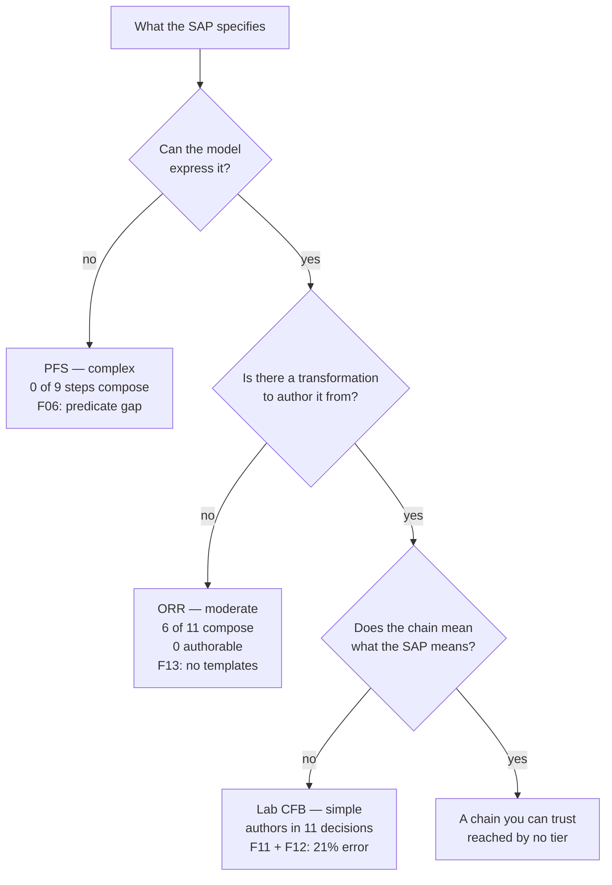

# usdm-acdc-in-practice

ICH M11, USDM v4.0 and the CDISC AC/DC framework — BC to DC to AC — learned by structuring one protocol and taking one endpoint the whole way through.

---

**Start with [`NORTH.md`](NORTH.md)** — the destination, the nine-stage finish line, and the
test any piece of work has to pass. **All nine stages are done, on two endpoints.** Phase 2
(P0–P6) fixed the study's gaps in the derived documents, generated the USDM from the M11
protocol, and — under P6, 2026-09-20 — made the documents correct rather than following the
data: the design is the combination the SAP describes, 2:1 stands, and every supplied element
says where it came from. Both endpoints were re-run on the corrected fragment the same day; no number changed. Then TORIVA
issue #27 closed, the source was re-pinned to its regenerated data (P7), and both were re-run again:
new numbers, the same divergence, each reproduced outside the engine.

**New to USDM, M11 or AC/DC?** Read [`docs/vignette.md`](docs/vignette.md) first — the whole
traverse in plain terms, with the three letters explained and every artefact linked. To **drive it
yourself**, [`docs/walkthrough.md`](docs/walkthrough.md) is the click-by-click guide, with a
[recording](docs/media/walkthrough-lab-endpoint.gif) of the lab endpoint start to finish.

## What this is

CDISC's [`cdisc-org/analysis-concepts`](https://github.com/cdisc-org/analysis-concepts) implements the AC/DC framework: an Observation / Derivation / Analysis Concept model, 60 methods, a transformation library, an eSAP model and a working browser-based builder with in-browser R execution.

This repository does not reimplement any of that, and does not assess it. It is a **learning
exercise**: restructure one real protocol to ICH M11, generate USDM v4 from it, and carry one
endpoint — laboratory change from baseline — through BC → DC → AC → eSAP → execution, ending at
a number that can be compared against built ADaM. [`NORTH.md`](NORTH.md) states the nine stages
and which of them are green.

Three endpoints of graded complexity were mapped on paper first, to find where the framework's
limits sit before committing to one. Two have been carried all the way: laboratory change from
baseline, and — added on 2026-09-19 — systolic blood pressure by MMRM and by ANCOVA.

The source study is [TORIVA-LUNG 301](https://github.com/OpenTrialReporting/torivumab-nsclc-301), a simulated Phase 3 NSCLC trial with a fictional sponsor. It was chosen because it is the only available source where protocol, SAP, programming specs and built ADaM all exist, are internally consistent, and carry no confidentiality constraint. That last point matters: without built ADaM there is no ground truth, and without ground truth the exercise only demonstrates internal coherence.

## The endpoint ladder

| Tier | Endpoint | Estimand | Expectation |
|---|---|---|---|
| Simple | Laboratory change from baseline | — | **Authored end to end.** Structure composes with no new authoring; semantics do not — the baseline it subtracts is ambiguous for 71% of the study. The SAP specifies no lab analysis, and the two lab tables that were built do not compose |
| Moderate | Objective response rate | E3 / E3a | **Mapped and attempted. Half composes on paper, none of it authorable** — the five composable steps have no transformation template, and templates cannot be created |
| Complex | Progression-free survival | E2 / E2a | **Mapped. Does not compose** — one of nine steps. Found the limit earlier than expected |

The simple tier matters *because* it is shallow — it shows the framework does not impose machinery where none is needed. The complex tier is a stress test, and a negative result there is a finding rather than a failure.

The CDISC Pilot's ADAS-Cog endpoint is retained as a control, since it is already worked upstream. When something breaks, it distinguishes a broken flow from a broken endpoint.

**Out of scope:** adverse events (a different shape — event observations, counts, OCCDS rather than BDS) and the remaining five ADTTE parameters.

## Why the lab tier

The ladder was built to vary *difficulty*. What it actually did was show which tier could be
carried to the finish line: each stops at a different one of three successive gates, and only
one reaches the third.



That is why the lab tier is the one carried to the finish line: it is the only tier that reaches
the third gate at all.

## Method

Each endpoint follows the same four steps, and the directory structure enforces the order:

1. **`mapping.md`** — map the chain on paper against the SAP text, before opening the builder.
   If it does not compose on paper, that is the finding. Doing this after authoring makes a
   negative result uninterpretable.
2. **`chain.json`** — the authored chain, saved as a builder study instance.
3. **`comparison.md`** — output against the built ADaM, with each divergence classified as model
   limitation, specification ambiguity, or authoring error.
4. **`log.md`** — every point where a decision was needed.

The eSAP (`esap.json`) sits after these, not among them. It is the **last artefact of the
builder's specification layer and the input to execution**: the study-level document that
binds an authored chain back to the study's objectives, endpoints and estimands from USDM.
It is not a fourth concept beside BC, DC and AC — it is the container the chain goes into.

Two corrections the work forced on this, both in [`docs/method.md`](docs/method.md):

**Steps 1 and 2 read different things.** Step 1 reads the *method* library and answers *can the
model express this*. Step 2 reads the *transformation* library and the builder, and answers
*can a chain be built*. Those differ on two of three tiers — 65% of methods have no
transformation (F13) — and both the ORR and PFS mappings had to be corrected after the fact.

**Step 4 records decisions, not hours.** It originally asked for elapsed time. An AI driving a
browser produces a wall-clock that is not a statistician's and does not scale like one;
reporting it as the cost figure would look like evidence and be none. PROVENANCE §7.9 has the
reasoning.

## Repository structure

```
.
├── NORTH.md                         the destination, finish line and test — read first
├── CLAUDE.md                        working rules for an AI collaborator
├── README.md
├── LICENSE                          MIT
├── .gitmodules
├── .githooks/
│   └── pre-commit                   runs the consistency check on every commit
├── upstream/
│   └── analysis-concepts/           submodule, pinned at 739344c, read-only
├── docs/
│   ├── specification.md             the original plan — §2 superseded by NORTH.md
│   ├── method.md                    how claims are verified, and the two surfaces
│   ├── vignette.md                  the whole traverse in plain terms — start here if new
│   ├── walkthrough.md               drive one endpoint through the builder yourself
│   ├── review-sheet-phase2.md       LG's review of phase 2 — claims with falsifiers
│   ├── contribution-mmrm.md         the M.MMRM implementation, packaged for upstream (not filed)
│   ├── review-plan.md               ⏸ parked — planned a review of the parked issues
│   └── findings/
│       ├── README.md                index and status of F01–F13
│       ├── F01 … F13                one file each, with evidence
│       └── upstream-issues.md       ⏸ parked — five drafts, none filed, none needed
├── study/
│   ├── README.md                    why TORIVA, what is used
│   ├── source-refs.md               pinned commits: upstream, TORIVA, ICH M11
│   ├── m11/
│   │   ├── protocol-to-m11.md       stage 0 — TORIVA mapped to M11 elements
│   │   └── protocol/                stage 0b — TORIVA restructured to M11
│   └── usdm/                        stage 1 / 0b — USDM v4, generated from the above
├── endpoints/
│   ├── 01-simple-lab-cfb/           mapping, chain.json, comparison, log — all four steps
│   ├── 02-moderate-orr/             mapping, chain.json, log — unauthorable, see F13
│   ├── 03-complex-pfs/              mapping only — does not compose, see F06
│   └── 04-vitals-cfb-mmrm/          second endpoint: MMRM + ANCOVA chains, our M.MMRM implementation, executed and compared
└── tools/
    ├── acdc_divergence.py           signature and divergence detection
    ├── check_consistency.py         documents vs. filesystem, and NORTH's scoreboard
    └── check_baseline_ambiguity.py  F12 against built ADaM (needs pyarrow)
```

Two deliberate choices:

**Upstream is a pinned submodule, not a copy.** Copying is easier in the moment and strands the repository on a divergent snapshot within two releases.

**TORIVA is referenced by commit, not vendored.** It is 81 MB and read-only input. `study/source-refs.md` pins the commit and points at the specific SAP sections and spec files used, so the work is reproducible without duplicating the study.

## Status

Nine of nine stages, on the lab tier. [`NORTH.md`](NORTH.md) carries the table, and `tools/check_consistency.py`
verifies it against the filesystem on every commit, so it cannot claim a stage that has not
happened.

| | |
|---|---|
| Stages 0, 0b — **M11** | TORIVA's protocol mapped to the merged M11 data elements, then **restructured**: §3, the title page and §12.1. M11 §3.1.1 requires the estimand *in the protocol*; TORIVA defers all five ICH E9(R1) attributes to the SAP and so fails **25 required elements** across six objectives (30 until the 2026-09-18 review) |
| Stages 1, 0b — **USDM** | `study/usdm/toriva-lung-301.usdm.json`, hand-authored and then **regenerated from the M11 protocol** — which took it from one estimand to six. Loads and renders in the builder |
| Stages 2, 3, 4 — **BC, DC, AC** | The lab chain carries seven TORIVA laboratory BCs on each measure terminal, `T.ChangeFromBaseline` as its derivation and `T.CFB_ANCOVA` as its analysis |
| Stage 5 — **eSAP** | Done. `endpoints/01-simple-lab-cfb/esap.json`, generated by step 7 from the lab chain — the study-level plan the chain goes into, and the input to step 8. Its estimand is assembled from **two sources**: USDM supplies the population summary and intercurrent events, the chain must supply analysis population and treatment |
| Stage 6 — **execution** | Done. `endpoints/01-simple-lab-cfb/results.json` — step 8 via WebR against TORIVA's ADLB. **The first number produced here:** ALT change from baseline at C2D1, torivumab − placebo = −1.830 (SE 1.768, n = 432). Eleven execution decisions, recorded as L7 |
| Stage 7 — **comparison** | Done, on the result. It does not match the same model on TORIVA's own `BASE` (−0.893); each run is reproduced to four decimals, and **70.1% of subjects** carry a different baseline row — the 71% predicted on paper, now measured |
| Moderate tier (ORR) | Mapped and attempted. **Composes at method level and cannot be authored** — the authorable chain has `derivationChain: []` |
| Complex tier (PFS) | Mapped. **Does not compose on paper** — F06. Steps 2–4 blocked |

The finish line is reached on **two endpoints**. The second — systolic blood pressure, change
from baseline, by MMRM and by ANCOVA (`endpoints/04-vitals-cfb-mmrm/`) — went through all nine
stages on 2026-09-19, with one thing the first did not need: an `M.MMRM` implementation written
by this project, because upstream ships none. Both endpoints diverge from TORIVA's built ADaM by
the same rule — the engine takes the first row in the Baseline window, TORIVA the `ABLFL` row —
on 70% and 74% of subjects. What comes next is a decision, not a stage.

Eighteen discrepancies inside TORIVA itself have surfaced from mapping (D1–D18), including one
that makes estimand E3 unimplementable as specified (`EFFFL` does not exist on ADRS) and one
where the SAP specifies no laboratory analysis at all, so the only statement of what the two
built lab tables compute is the R program that computes them. All are recorded in
`study/source-refs.md` and left unresolved, so as not to contaminate the step-3 comparison.

The **snapshot** of `docs/specification.md` §6.2 stays deferred until the finish line is green,
per `NORTH.md`. Two of its four axes have no content to render.

## Notes from the traverse

Thirteen findings came out of the mapping and the authoring, written up in
[`docs/findings/`](docs/findings/README.md) with the commands and output that establish each.

They are **by-products, not the product.** `NORTH.md` says why: findings about what a framework
cannot do are cheap to produce, feel like progress, and advance no stage. One is recorded when it
blocks a stage, and then left alone. **Nothing is being filed** — the five upstream issue drafts
and the review plan are parked.

Three are framework understanding rather than defect reports, and are the ones worth reading:

| | Claim | What it teaches |
|---|---|---|
| [F06](docs/findings/F06-no-general-predicate.md) | No general predicate exists over more than one variable | The outer boundary of what a DC can express: `M.ConditionalValue` is hardwired to `IF(IS_NA(…))` and `M.ThresholdCompare` compares one input to a constant. This is what blocks PFS entirely |
| [F12](docs/findings/F12-baseline-flag-and-baseline-value-are-disconnected.md) | The baseline flag and the baseline value are disconnected | How the pipeline resolves a dependency — by **output concept, exact string equality**. A `Flag` can therefore never satisfy a `Measure`, whatever it means |
| [F13](docs/findings/F13-authoring-surface-is-narrower-than-the-model.md) | The authoring surface is far narrower than the model | Method ≠ transformation ≠ builder. **39 of 60 methods have no template**, and a chain is authored from templates, not from methods |

The other ten — F01 through F05 and F07 through F11 — are mostly gaps in library content. Their
status, including the two corrected and the one retired, is in
[`docs/findings/README.md`](docs/findings/README.md).

The most transferable thing there is not any single finding but the error rate. **Five had a
premise or a proposed fix disproved** — F01, F02, F04, F07, F09 — four of them after being
drafted for public filing, and three failed the same way: inferring what the application does
from library JSON without running it. That is why [`CLAUDE.md`](CLAUDE.md) now requires the app
to be served before a claim about it stands.

## Provenance

Substantially all prose in this repository was drafted by an AI model and **has not yet been
human-reviewed**. Two of the five original findings were wrong as written and were caught only
by verification; three more were caught later, by unrelated work. Read
[`PROVENANCE.md`](PROVENANCE.md) before relying on anything here, and
[`docs/method.md`](docs/method.md) for how claims are checked.

Content based on [CDISC Analysis Concepts (GitHub)](https://github.com/cdisc-org/analysis-concepts)
used under the [CC-BY-4.0](https://creativecommons.org/licenses/by/4.0/) license.

## Licence

MIT. Upstream `cdisc-org/analysis-concepts` is MIT and CC-BY-4.0; TORIVA-LUNG 301 is referenced, not redistributed.

CDISC Library content is not included. The upstream cache is gitignored by design and each developer regenerates it with their own API key.
