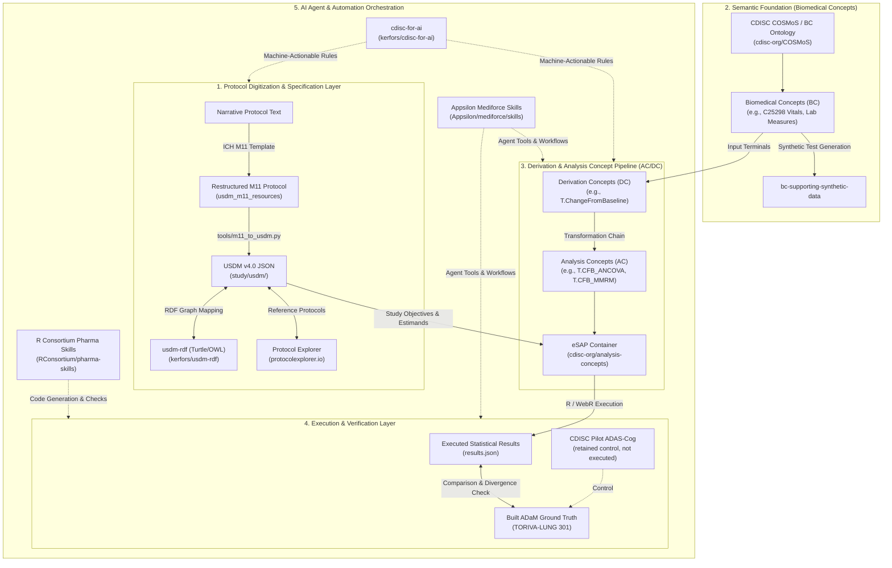

# The Big Picture: USDM, M11 & AC/DC Architectural Landscape

This document synthesizes the 10 core open-source reference projects listed in [`references.md`](references.md) into a unified, 5-layer architectural ecosystem for digital clinical trials and biostatistical automation.

> **Provenance.** Drafted with an AI model on 2026-09-24 and corrected against the repository on 2026-09-26: execution figures updated to the current TORIVA pin, the ADAS-Cog control stated as it stands (retained, not executed), and "role" lines for references this repository does not use restated as such. Like the rest of the repository's prose, not yet human-reviewed — see `PROVENANCE.md`.

---

## Architectural Diagram



---

## Fundamental Concept: ICH M11 vs USDM (The Bridge)

Understanding the relationship between **ICH M11** and **CDISC USDM** is foundational to digital clinical trials and biostatistical automation:

* **ICH M11 (The Document Template — Human-Readable Narrative)**  
  Defines the standardized chapter layout (14 sections), table structures, and mandatory headings for clinical trial protocols (e.g., *Section 3.1.1 Primary Objective & Estimand*).
* **CDISC USDM (The Data Model — Machine-Readable JSON Graph)**  
  Defines the software schema—JSON classes (`Objective`, `Endpoint`, `Estimand`), unique IDs, and relationships—that stores protocol metadata in databases, AI tools, and statistical engines.

### Side-by-Side "Show & Tell"

| Feature | ICH M11 (`study/m11/protocol/section-03-objectives-endpoints.md`) | USDM v4.0 JSON (`study/usdm/toriva-lung-301.usdm.json`) |
|---|---|---|
| **Target Audience** | Human clinicians, regulators, biostatisticians | Software engines, R pipelines, AI agents |
| **Format** | Markdown / DOCX / PDF headings | Structured JSON object graph |
| **Representation** | ```markdown<br/># 3. Trial Objectives, Endpoints and Estimands<br/>## 3.1 Primary Objective & Estimand<br/>* **Objective (C85826)**: Demonstrate OS superiority.<br/>* **Endpoint (C25212)**: Overall Survival.<br/>* **Population (C70833)**: ITT Population.<br/>``` | ```json<br/>{<br/>  "id": "Objective_1",<br/>  "instanceType": "Objective",<br/>  "text": "Demonstrate OS superiority",<br/>  "level": {"code": "C85826", "decode": "Primary Objective"},<br/>  "endpoints": [{"id": "Endpoint_OS", "instanceType": "Endpoint"}]<br/>}<br/>``` |

### Why This Bridge Matters


Without ICH M11, protocol authors bury estimands across separate document sections or defer them to the SAP. Enforcing **ICH M11** guarantees that every critical protocol concept has a deterministic address in the text—enabling software scripts (`tools/m11_to_usdm.py`) and AI extraction pipelines (`soa2usdm`) to generate valid **USDM JSON** automatically without human guesswork.

---

## 5-Layer Ecosystem Breakdown

### Layer 1: Protocol Digitization & Specification Layer
Captures narrative protocol text into structured, machine-actionable study metadata conforming to ICH M11 and CDISC USDM.

* **[Protocol Explorer](https://protocolexplorer.io/)**: Real-world library of protocols mapped to USDM for reference benchmarking.
* **[USDM and M11 Resources](https://github.com/data4knowledge/usdm_m11_resources)**: Cross-mapping resources between TransCelerate M11 protocol templates and USDM attributes.
* **[D4K USDM Workbench](https://github.com/data4knowledge/study_definitions_workbench)**: Interactive workbench for authoring and manipulating USDM study instances.
* **[usdm-rdf](https://github.com/kerfors/usdm-rdf)**: Turtle (RDF/OWL) ontology representation of CDISC USDM v4 for semantic graph queries.
* **[soa2usdm](https://github.com/kerfors/soa2usdm)**: Automated pipeline for extracting protocol Schedule of Activities (SoA) into USDM encounter and activity structures.

### Layer 2: Semantic Foundation (Biomedical Concepts)
Establishes standardized domain concepts, variables, and observation semantics prior to mathematical transformations.

* **[CDISC Biomedical Concepts (COSMoS)](https://github.com/cdisc-org/COSMoS)**: Foundational ontology defining Biomedical Concepts (BCs), variables, codelists, and attributes.
* **[bc-supporting-synthetic-data](https://github.com/pendingintent/bc-supporting-synthetic-data)**: BC-aligned synthetic data generation for testing end-to-end pipelines when real study data is unavailable.

#### Side-by-Side "Show & Tell": Narrative $\rightarrow$ COSMoS BC $\rightarrow$ Chain Terminal Binding

| Protocol Narrative Text | COSMoS BC Ontology (`cdisc-org/COSMoS`) | USDM / Chain Terminal Binding (`chain.json`) |
|---|---|---|
| *"Systolic Blood Pressure measured sitting (mmHg)"* | **BC ID**: `C25298`<br/>**Name**: Systolic Blood Pressure<br/>**Domain**: Vital Signs (`VS`) | ```json<br/>{<br/>  "id": "Terminal_SYSBP",<br/>  "linkedBCIds": ["BiomedicalConcept_SYSBP"],<br/>  "name": "Systolic Blood Pressure"<br/>}<br/>``` |
| *"Alanine Aminotransferase (ALT/SGPT) lab test"* | **BC ID**: `C64433`<br/>**Name**: Alanine Aminotransferase<br/>**Domain**: Laboratory (`LB`) | ```json<br/>{<br/>  "id": "Terminal_ALT",<br/>  "linkedBCIds": ["BiomedicalConcept_ALT", "BiomedicalConcept_AST", "…"],<br/>  "name": "Alanine Aminotransferase"<br/>}<br/>``` |

The chain terminal does not carry the NCIt code. `linkedBCIds` points at the BC in the USDM fragment (`BiomedicalConcept_SYSBP`; for the lab chain, seven laboratory BCs), and that BC's `reference` points at the COSMoS dataset specialization (`SYSBP`, `ALTSERPL`). This terminal-level join is independent of USDM's `Endpoint.biomedicalConceptIds`, which the builder does not read (`NORTH.md`, stage 2).

#### Why Layer 2 is Critical
Biomedical Concepts decouple **WHAT was measured** from **HOW it is stored in a file**. Whether the underlying dataset names the variable `SYSBP`, `AVAL`, `LBSTRESN`, or `VSSTRESN`, the derivation chain binds directly to the universal semantic code (`C25298` or `C64433`).

### Layer 3: Derivation & Analysis Concept Pipeline (AC/DC)
Composes observation terms into mathematical transformations (Derivation Concepts) and statistical models (Analysis Concepts), binding them with USDM metadata into an electronic Statistical Analysis Plan (**eSAP**).

* **[cdisc-org/analysis-concepts](https://github.com/cdisc-org/analysis-concepts)**: Core upstream framework providing 60 derivation/analysis methods, transformation chains, WebR engine, and the eSAP model builder.

#### Side-by-Side "Show & Tell": BC $\rightarrow$ DC $\rightarrow$ AC $\rightarrow$ eSAP

| Concept Level | Architectural Role | Example in `usdm-acdc-in-practice` |
|---|---|---|
| **BC (Biomedical Concept)** | Observation Terminal | Systolic Blood Pressure (`C25298`) |
| **DC (Derivation Concept)** | Mathematical Transformation | `T.ChangeFromBaseline` ($CHG = VAL_{visit} - VAL_{baseline}$) |
| **AC (Analysis Concept)** | Statistical Model | `T.CFB_MMRM` (Mixed Model Repeated Measures) or `T.CFB_ANCOVA` |
| **eSAP Container** | Executable Study Plan | `endpoints/04-vitals-cfb-mmrm/esap.json` |

#### Core Boundaries Discovered at Layer 3
* **F06 (Expressiveness Boundary)**: Lack of multi-variable predicates blocks complex endpoints like Progression-Free Survival (**PFS**).
* **F13 (Authoring Boundary)**: 65% of method definitions lack transformation templates; Objective Response Rate (**ORR**) composes on paper but cannot be authored.
* **F12 (Semantic Disconnect)**: The pipeline resolves a dependency by output concept, so a baseline Flag can never satisfy a baseline Measure. In execution the engine takes the first row in the Baseline window rather than the `ABLFL` row.

### Layer 4: Execution, Ground Truth & Audit Layer
Executes eSAP specifications against study datasets via R/WebR and audits automated pipeline outputs against human-authored built ADaM ground truth.

* **[Atorus CDISC Pilot Replication](https://github.com/atorus-research/CDISC_pilot_replication)**: R-based replication of the CDISC pilot project. Listed as a reference; not used here. The ADAS-Cog control this repository retains is the CDISC Pilot endpoint as already worked in `cdisc-org/analysis-concepts`, and no run of it is recorded (`study/README.md`).
* **[TORIVA-LUNG 301](https://github.com/OpenTrialReporting/torivumab-nsclc-301)**: Simulated Phase 3 NSCLC trial (fictional sponsor) providing protocol, SAP, programming specs, and built ADaM datasets for empirical comparison.

#### Side-by-Side "Show & Tell": Automated Execution vs Built ADaM Ground Truth

| Metric / Stage | Automated Engine Execution (`results.json`) | Built ADaM Ground Truth (TORIVA ADaM) | Discrepancy / Root Cause |
|---|---|---|---|
| **Lab CFB (ALT at C2D1), ANCOVA** | torivumab − placebo = **−1.276** (SE 2.215, n=429) | **−1.305** (SE 1.607, n=427), the same model on TORIVA's `CHG`/`BASE` | **68.6% of subjects** (293/427) carry a different baseline row (`F12`) |
| **Vitals SBP CFB at C2D1, MMRM** | torivumab − placebo = **−4.44** (SE 1.909), this repository's `M.MMRM` in WebR; reproduced exactly by an R refit of the engine's selection | **−1.80** (SE 1.450), `mmrm` on TORIVA's `CHG`/`BASE`/`ANL01FL` | **72.0% of subjects** (322/447) — the same rule as the lab tier |
| **ADAS-Cog control** | Not executed | — | Retained as a control only; no run is recorded |

Figures at TORIVA pin `a806630` (P7, 2026-09-20), from each endpoint's `comparison.md`; engine output is sign-reversed there and restated here as torivumab − placebo. Before the regeneration the lab tier stood at −1.830 against −0.893, with 70.1% divergent.

#### Core Lesson of Layer 4
Without comparing automated outputs against human-authored built ADaM ground truth, an automated pipeline can only prove **internal coherence**, not **statistical correctness**. 

By auditing automated results against TORIVA's built ADaM data, Layer 4 uncovered that **69% to 72% of subjects diverge** at the current pin (70% to 74% before the P7 regeneration), because the engine takes the first row in the Baseline window rather than the row the statistician flagged (`ABLFL`). The rule survived a full regeneration of the data, which is what makes it the selection rule and not the data.

---

### Layer 5: AI Agent & Automation Orchestration Layer
Empowers LLMs and autonomous AI coding agents with domain-specific skills, prompt patterns, and machine-actionable specifications.

* **[cdisc-for-ai](https://github.com/kerfors/cdisc-for-ai)**: Formats CDISC standards into machine-actionable specifications for AI tools.
* **[Appsilon Mediforce Skills](https://github.com/Appsilon/mediforce/tree/main/skills)**: Reusable AI agent skills for clinical data engineering and biostatistics.
* **[R Consortium Pharma Skills](https://github.com/RConsortium/pharma-skills)**: Specialized agent skills and prompts for biostatistics and R programming workflows.

#### Side-by-Side "Show & Tell": AI Tooling $\rightarrow$ Agent Execution

| AI Reference Resource | Role in AI Agent Orchestration | Implementation / Equivalent in Repository |
|---|---|---|
| **[cdisc-for-ai](https://github.com/kerfors/cdisc-for-ai)** | Formats CDISC standards into JSON/YAML for LLM reasoning | `study/m11/protocol/coverage.json` & `tools/m11_to_usdm.py` |
| **[Mediforce Skills](https://github.com/Appsilon/mediforce/tree/main/skills)** | Modular agent instruction sets for clinical data tasks | Agent skill system & prompt instructions |
| **[Pharma Skills](https://github.com/RConsortium/pharma-skills)** | Standardized biostatistical R prompting patterns | [`CLAUDE.md`](../CLAUDE.md) project working rules & verification scripts |

---

## Reference Mapping Summary

| # | Reference | GitHub Repository / Link | Ecosystem Layer | Key Function |
|---|---|---|---|---|
| 1 | Protocol Explorer | [protocolexplorer.io](https://protocolexplorer.io/) | Layer 1 | Protocol USDM reference library |
| 2 | CDISC Analysis Concepts | [cdisc-org/analysis-concepts](https://github.com/cdisc-org/analysis-concepts) | Layer 3 & 4 | Core AC/DC framework & WebR engine |
| 3 | USDM & M11 Resources | [data4knowledge/usdm_m11_resources](https://github.com/data4knowledge/usdm_m11_resources) | Layer 1 | M11 template $\leftrightarrow$ USDM mapping |
| 4 | CDISC COSMoS | [cdisc-org/COSMoS](https://github.com/cdisc-org/COSMoS) | Layer 2 | Biomedical Concepts ontology |
| 5 | D4K USDM Workbench | [data4knowledge/study_definitions_workbench](https://github.com/data4knowledge/study_definitions_workbench) | Layer 1 | USDM study definition workbench |
| 6 | Appsilon Mediforce Skills | [Appsilon/mediforce/skills](https://github.com/Appsilon/mediforce/tree/main/skills) | Layer 5 | AI agent skills for clinical workflows |
| 7 | Atorus CDISC Pilot Replication | [atorus-research/CDISC_pilot_replication](https://github.com/atorus-research/CDISC_pilot_replication) | Layer 4 | Reference only (not used) |
| 8 | R Consortium Pharma Skills | [RConsortium/pharma-skills](https://github.com/RConsortium/pharma-skills) | Layer 5 | Biostatistical LLM skills |
| 9a | cdisc-for-ai | [kerfors/cdisc-for-ai](https://github.com/kerfors/cdisc-for-ai) | Layer 5 | Machine-actionable CDISC for AI |
| 9b | usdm-rdf | [kerfors/usdm-rdf](https://github.com/kerfors/usdm-rdf) | Layer 1 | Turtle (RDF/OWL) USDM v4 representation |
| 9c | soa2usdm | [kerfors/soa2usdm](https://github.com/kerfors/soa2usdm) | Layer 1 | SoA to USDM extraction pipeline |
| 10 | BC to Synthetic Data | [pendingintent/bc-supporting-synthetic-data](https://github.com/pendingintent/bc-supporting-synthetic-data) | Layer 2 | BC-aligned synthetic data generation |

---

## Detailed Analysis of Each Reference

### 1. Protocol Explorer ([protocolexplorer.io](https://protocolexplorer.io/))
* **Scope & Purpose**: A web-based reference library and visualization tool displaying real-world clinical trial protocols digitized into USDM.
* **Key Components**: Protocol browser, study structure inspector, encounter/activity schedule viewer.
* **Role in `usdm-acdc-in-practice`**: Serves as a reference model for how digital protocol structures look when rendered. The USDM JSON generated for TORIVA-LUNG 301 (`study/usdm/toriva-lung-301.usdm.json`) conforms to the same USDM v4.0 semantics shown in Protocol Explorer.

### 2. CDISC Analysis Concepts ([cdisc-org/analysis-concepts](https://github.com/cdisc-org/analysis-concepts))
* **Scope & Purpose**: The primary upstream CDISC framework defining the Observation / Derivation / Analysis Concept model, method definitions, transformation library, and eSAP builder with WebR execution.
* **Key Components**:
  * `lib/methods/`: 60 atomic mathematical and statistical method definitions.
  * `lib/transformations/`: Transformation library binding methods to data inputs.
  * `ac-dc-app/`: Web app UI and WebR engine (`acdc_engine.R`) executing statistical chains in R.
* **Role in `usdm-acdc-in-practice`**: Pinned as a read-only submodule under `upstream/analysis-concepts` (`739344c`). This repository learns it without mutating it — the thing being learned, not assessed (`NORTH.md`) — and authored `docs/contribution-mmrm.md` (`M.MMRM` implementation) to extend it.

### 3. USDM and M11 Resources ([data4knowledge/usdm_m11_resources](https://github.com/data4knowledge/usdm_m11_resources))
* **Scope & Purpose**: Cross-mapping documentation and resources linking TransCelerate / ICH M11 protocol template sections to CDISC USDM data entities.
* **Key Components**: M11 element dictionary, field mapping tables, and template alignment guidelines.
* **Role in `usdm-acdc-in-practice`**: Source of the M11 specification this repository maps against (`m11_specification_v0-17-0`, pinned in `study/source-refs.md`), used for `study/m11/protocol-to-m11.md`. Its USDM ↔ M11 class mapping is not yet used; `tools/m11_to_usdm.py` was written here.

### 4. CDISC Biomedical Concepts / COSMoS ([cdisc-org/COSMoS](https://github.com/cdisc-org/COSMoS))
* **Scope & Purpose**: Core Ontology for Study Modeling and Standards (COSMoS), defining standardized Biomedical Concepts (BCs) for clinical domain data.
* **Key Components**: NCIt concept codes, variable definitions, codelists, attributes, and relationships.
* **Role in `usdm-acdc-in-practice`**: Defines the semantic terminals for authored chains. In Stage 2 (`NORTH.md`), chain inputs (e.g. `endpoints/01-simple-lab-cfb/chain.json` and `endpoints/04-vitals-cfb-mmrm/chain.json`) link to the USDM fragment's BCs through `linkedBCIds`, whose `reference` points at COSMoS dataset specializations such as `SYSBP` (Systolic Blood Pressure, NCIt `C25298`) and `ALTSERPL`.

### 5. D4K USDM Workbench ([data4knowledge/study_definitions_workbench](https://github.com/data4knowledge/study_definitions_workbench))
* **Scope & Purpose**: Open authoring environment and workbench for creating, editing, and validating USDM study definition JSON files.
* **Key Components**: USDM editor UI, schema validation utilities, and export/import tools.
* **Role in `usdm-acdc-in-practice`**: Listed as a reference for USDM authoring and validation; not used here.

### 6. Appsilon Mediforce Skills ([Appsilon/mediforce/skills](https://github.com/Appsilon/mediforce/tree/main/skills))
* **Scope & Purpose**: A repository of modular AI agent skills for clinical data engineering, CDISC data transformations, and biostatistical pipelines.
* **Key Components**: Instruction sets, CLI tool integrations, and automation workflows.
* **Role in `usdm-acdc-in-practice`**: Demonstrates how autonomous AI coding agents can execute standardized clinical data tasks via skill files.

### 7. Atorus CDISC Pilot Replication ([atorus-research/CDISC_pilot_replication](https://github.com/atorus-research/CDISC_pilot_replication))
* **Scope & Purpose**: Complete R replication of the original CDISC ADaS-Cog Pilot study using modern R packages (`pharmaverse`).
* **Key Components**: R scripts for SDTM $\rightarrow$ ADaM derivation and TLF generation.
* **Role in `usdm-acdc-in-practice`**: Listed as a reference; not used here. The ADAS-Cog control this repository retains is the CDISC Pilot endpoint as worked upstream in `cdisc-org/analysis-concepts`; no ADAS-Cog run is recorded, so it has not yet verified the WebR engine against anything.

### 8. R Consortium Pharma Skills ([RConsortium/pharma-skills](https://github.com/RConsortium/pharma-skills))
* **Scope & Purpose**: Community-driven repository of AI skills and prompt templates maintained by the R Consortium Pharma Working Group.
* **Key Components**: Prompt templates for generating `rtables`, `gt` summaries, SDTM/ADaM checks, and biostatistical code.
* **Role in `usdm-acdc-in-practice`**: Listed as a reference; not used here.

### 9. Kerfors Repositories ([kerfors](https://github.com/kerfors))
* **9a. `cdisc-for-ai`**: Machine-actionable CDISC specifications structured in JSON/YAML for LLMs and AI agents.
* **9b. `usdm-rdf`**: Turtle (RDF/OWL) ontology representation of CDISC USDM v4, enabling semantic graph queryability via SPARQL.
* **9c. `soa2usdm`**: Extraction pipeline with schemas and prompts for parsing narrative Schedule of Activities (SoA) tables into USDM JSON.
* **Role in `usdm-acdc-in-practice`**: Listed as references; not used here. Neither `soa2usdm` nor `cdisc-for-ai` is cited in `tools/m11_to_usdm.py` or `CLAUDE.md`; the schedule of activities is generated from the restructured protocol by this repository's own tool.

### 10. Biomedical Concepts to Synthetic Data ([pendingintent/bc-supporting-synthetic-data](https://github.com/pendingintent/bc-supporting-synthetic-data))
* **Scope & Purpose**: Generator for synthetic clinical trial datasets that adhere to CDISC Biomedical Concept specifications.
* **Key Components**: Synthetic data schemas, random generator scripts, and BC mapping logic.
* **Role in `usdm-acdc-in-practice`**: Provides a solution for pipeline testing when real study data cannot be shared. Highlighted the reason `usdm-acdc-in-practice` chose TORIVA-LUNG 301 (which provides unencumbered, open built ADaM ground truth).

---

## Core Learnings from `usdm-acdc-in-practice`

1. **Protocol Gaps Surface Early**: Digitizing the protocol to ICH M11 and USDM exposes missing estimand attributes or protocol ambiguities before programming starts.
2. **Expressiveness Limits**: Linear endpoints (Laboratory change from baseline, MMRM vitals) compose end-to-end, while complex multi-variable predicates (e.g. PFS) hit structural limits (`F06`).
3. **Execution Divergence**: Differences between engine baseline window rules and statistician baseline flags (`ABLFL`) produce predictable, measurable divergences against built ADaM data (`F12`).
