# Drive one endpoint through the builder yourself

Phase 2, stage **P4** (`NORTH.md`). Click by click, from what was actually clicked on the two
endpoints. Everything below runs on the **aligned study** — the USDM generated from the M11
protocol, itself restructured from TORIVA's synopsis at the pinned commit — and on TORIVA's real
datasets. You will see the number the repository reports come out of the browser.

- **Time** about forty-five minutes for the laboratory endpoint; the vital-signs MMRM is a second pass of the same steps plus one extra
- **Application** `cdisc-org/analysis-concepts` at `739344c`
- **Study** documents at `0f78331`, datasets as regenerated under #27 at `a806630`
- **Result to expect** `endpoints/01-simple-lab-cfb/results.json`, `p7_rerun_a806630`
- **Recording** [`media/walkthrough-lab-endpoint.gif`](media/walkthrough-lab-endpoint.gif) — the lab endpoint start to finish, 50 frames, 10 MB, no sound. The typing at step 3 and the node clicks at step 6 are not in it: the saved chain was loaded at that point, so those frames show the outcome rather than the keystrokes

Each step shows the screen it is about, taken from the app at `739344c` on 2026-10-02 with the
study loaded. The runs that shaped this page, with their dates, are collected at the end rather
than in the steps.

---

## 0. Before you open the browser

**The short way**: one command does everything in this section except the two once-per-clone
git settings —

```
python tools/walkthrough.py serve
```

While it runs, **this guide is served as a page at `http://localhost:8080/walkthrough`** — open it in
a second tab beside the app. Without the server, `python tools/walkthrough.py html` writes the same
page as a file you can open directly.

It checks that your TORIVA checkout is at the pin, converts ADSL, ADLB and the induction-window
ADVS to `.xpt`, stages the study, the three saved chains and the M.MMRM implementation into the
app, serves it at `http://localhost:8080/ac-dc-app/index.html`, and on Ctrl-C removes everything it
staged so the submodule is clean again. The page it serves carries a small overlay of its own —
a *(no filter)* entry in every slice dropdown, the M.MMRM implementation registered, the `mmrm`
package installed once the engine is up — so every step below is done on the page, none in the
browser console. The upstream app has none of that; the guide says at each point what the
overlay supplied. About a minute before the URL answers, most of it the ADLB conversion.
`stage` and `clean` are the two halves on their own; if the server was killed rather than
stopped, run `clean`. The command refuses to start while something else holds port 8080, and
says which process. The staged files are at `ac-dc-app/data/toriva/` for step 8's upload dialog.

::: warn If you see "Failed to load data — Failed to fetch"
That is the server, not the app. Upstream's `python ac-dc-app/serve.py` is single-threaded with
a listen backlog of five, and the app fires about twenty-two fetches at once on load, some of
which get dropped. `walkthrough.py serve` serves the same directory with the same no-cache
headers from the standard library's threading server, which does not drop them.
:::

**Check the pin first.** `python tools/check_alignment.py --require-data` should print `PASS documents pin`
with the commit `study/source-refs.md` names (`0f78331` at the time of writing). If it says WARN, your
TORIVA checkout is not at the pin and the numbers below will not be yours.

::: details The long way — what the command does by hand

Once per clone, the first block:

```
git config core.hooksPath .githooks
git -C upstream/analysis-concepts config core.autocrlf false
git -C upstream/analysis-concepts checkout -- ac-dc-app/r/acdc_engine.R
pip install pyarrow pyreadstat
```

The second and third lines matter on Windows: with `autocrlf=true` the engine's R source is
checked out with CRLF and step 8 fails to parse it (`unexpected invalid token`).

**Data.** TORIVA ships parquet; the builder wants `.xpt`. From the checkout of
`OpenTrialReporting/torivumab-nsclc-301` at the pin:

```python
import pyarrow.parquet as pq, pyreadstat
for name in ("adsl", "adlb"):
    df = pq.ParquetFile(f"<toriva>/datasets/adam/{name}.parquet").read().to_pandas()
    for c in df.columns:
        if str(df[c].dtype) in ("object", "str", "string"):
            df[c] = df[c].astype(str).where(df[c].notna(), None)
    pyreadstat.write_xport(df, f"{name}.xpt", file_format_version=5, table_name=name.upper())
```

**Stage the study into the app** (a throwaway edit inside the submodule — revert it after):

```
cd upstream/analysis-concepts
cp ../../study/usdm/toriva-lung-301.usdm.json ac-dc-app/data/usdm/
```

and add a line `{ "file": "toriva-lung-301.usdm.json" }` to `ac-dc-app/data/usdm/studies.json`.
Then `python ac-dc-app/serve.py` and open `http://localhost:8080/ac-dc-app/index.html`.

When you are done: `git checkout -- ac-dc-app/data/usdm/studies.json` and delete the copied
file, so the submodule is clean at `739344c`.
:::

## 1. Select Study

Three cards. Click **TORIVA-LUNG 301**. The card says *2 Arms · 6 Objectives · 7 Endpoints*.

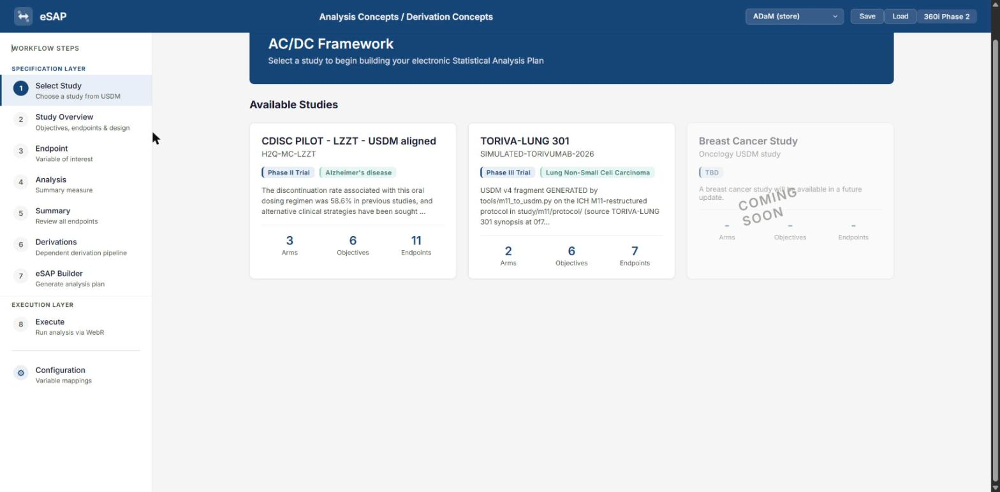

*What you are looking at:* the USDM file, parsed. The rationale paragraph on the next page is
the generator's own provenance note — it names `tools/m11_to_usdm.py`.

::: warn Click the card before loading a saved chain
Loading a saved chain (the **Load** button, or the console line the server prints) selects the
chain's study but does not make its definition the active one. On a fresh page the active
definition is the first study's, the CDISC Pilot, and step 7 then builds the plan from it —
the Pilot's study block, and no estimand for your endpoint. Clicking the card is what sets the
active definition, so do it first.
:::

## 2. Study Overview

Tabs across the top. Two to look at:

- **Arms** — *Torivumab + Chemotherapy* and *Placebo + Chemotherapy*, as the source protocol
  states. The notes on each arm carry the history of that wording.
- **Schedule of Activities** — *13 activities · 39 encounters*, generated from the protocol's
  two assessment tables. Clicking a concept opens its panel. The seven laboratory concepts and
  SYSBP link to their SDTM dataset specializations where the pilot's fragment gave the
  identifier; creatinine and neutrophils have none, and say so in their notes.

::: note A concept's *Reference* link needs a CDISC Library key
**Its *Reference* link opens the concept's SDTM dataset specialization in the CDISC Library — if
you gave the server a key.** Without one, the link goes to the Library API directly and answers
401 (`Access denied due to missing subscription key`). To make it work:

1. Sign in at [library.cdisc.org](https://library.cdisc.org) (a free account) and copy your **API
   key** from your account page.
2. Save it once, as the only line of a file named `.cdisc-api-key` in the repository root (the
   file is git-ignored) or in your home directory. Then start the server as usual:

   ```
   python tools/walkthrough.py serve
   ```

   `stage` reports *CDISC_API_KEY set: 6 concept references routed through /cdisc-library/*. (An
   environment variable `CDISC_API_KEY` works too and takes precedence, if you prefer that.)
   The server forwards those requests to the Library with the key; the fragment in the
   repository is not changed, only the staged copy.
3. Click **Reference** again: the specialization opens in a new tab as a page — the domain,
   source and package, the parent biomedical concept as a link, and a table of the variables
   with their roles, codelists, assigned terms and relationships. A *raw JSON* link at the top
   gives the document as the Library sent it.
:::

Then **Objectives & Endpoints**: tick **END-S5-LAB** (under OBJ-S5). One endpoint selected.
Click **Specify Endpoints →**, top right.

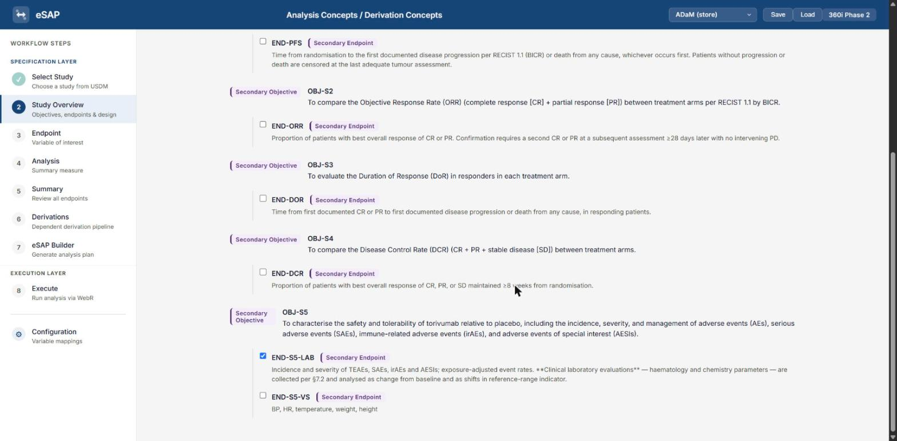

## 3. Endpoint — what is measured


- **Concept category:** *Change (Comparison)*. Data type stays *Quantity*.
- The **Smart Phrases** panel appears on the right. Tick **Population**, **Treatment grouping**,
  **Timepoint**, and **ANCOVA method**.
- Two small dropdowns inside the **Parameter** and **Timepoint** rows of the Smart Phrases panel
  choose the *form* of the dimension. Set **Parameter (DC, label form — PARAM-equivalent)** and
  **AnalysisVisit (DC, analysis-derived visit)**. **Do not tick the Parameter box** for this: it
  stays unticked, its dropdown works anyway, and the Parameter dimension is in the endpoint's data
  cube whether or not the box is ticked. The Timepoint box is one of the four you ticked above,
  so its dropdown is in a ticked row.

::: why
The engine filters on dimension names as literal columns of the data. The OC forms
(`Observation.Identification.Topic`, `Visit`) have no column in ADaM; the DC forms are `PARAM`
and `AVISIT`. Set wrongly here, the chain reaches step 8 and fails there.
:::

- **Dimension Values:** Parameter → type `Alanine Aminotransferase` (the label, not `ALT`);
  Population → *SAF*; Treatment → *Torivumab + Chemotherapy vs Placebo + Chemotherapy*;
  AnalysisVisit → pick **Cycle 2 Day 1** from its dropdown; **Visit** (the free-text box labelled
  *VISIT/VISITNUM*) → type `C2D1`. A dimension left empty here gets no row in step 8's slices
  table, so this is the only place the collected-visit slice can be created.

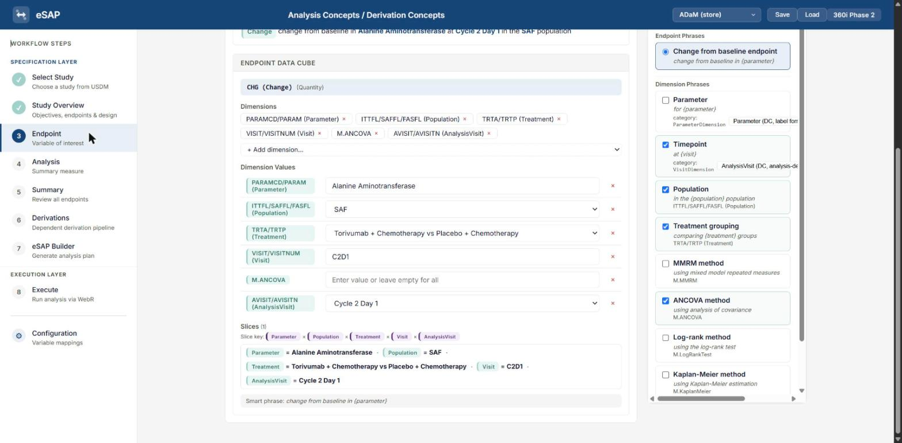

::: why Two names for one visit
The AnalysisVisit dropdown lists the study's encounters by the label the protocol gives them,
*Cycle 2 Day 1*, because the fragment's schedule was generated from the protocol. The data's
analysis-visit code is the SAP's, `C2D1`. `C2D1` is not offered here, and *Cycle 2 Day 1*
matches nothing in the data, so at step 8 you will re-pick the value from the data's own list
(item 5 there).
:::

The composed phrase at the bottom should read:

*change from baseline in Alanine Aminotransferase in the SAF population at Cycle 2 Day 1
comparing Torivumab + Chemotherapy vs Placebo + Chemotherapy groups using analysis of covariance*

It says *Cycle 2 Day 1*, the protocol's label, because that is what the dropdown offered; the
data's `C2D1` comes at step 8.

## 4. Analysis — how it is analysed

Tick **Change From Baseline ANCOVA** in the templates panel. The card shows the bindings:
response `CHG (Change)`, covariate `AVAL @ Parameter=Alanine Aminotransferase,
AnalysisVisit=Baseline`, fixed effect `TRTP (Treatment)`, and the model expression
`CHG ~ AVAL@Parameter_baseline + TRTP`. Type III, alpha 0.05.

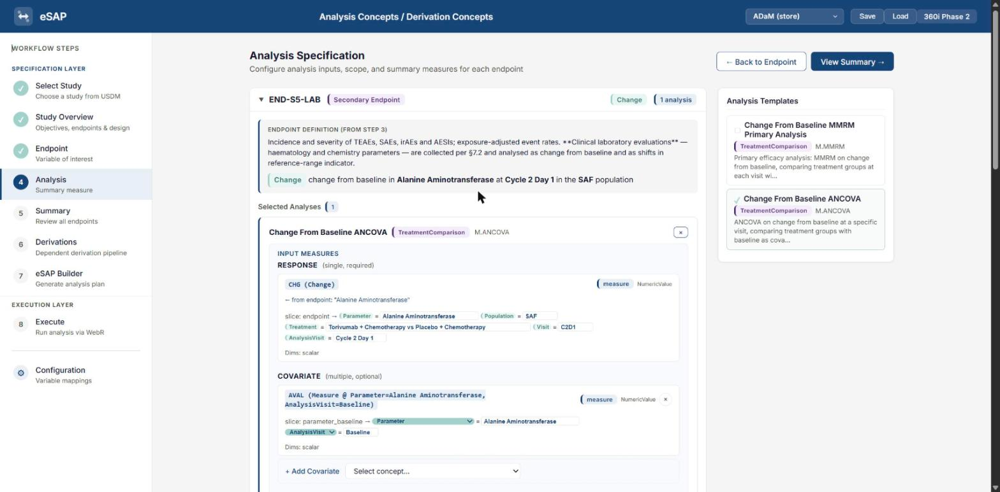

::: warn If the page goes blank here
A template can bind a role to a *kind* of dimension rather than a dimension, and the app can
leave that binding unresolved on selection, after which the page cannot render. Reload and
select the template again. If it persists, this is the one place the guide cannot get you
through the UI: `endpoints/04-vitals-cfb-mmrm/log.md` item V1 has the two-line console fix.
:::

## 5. Summary

One card: *Change from baseline in Alanine Aminotransferase at C2D1*. Note **0 With Estimand**
— the card reads the chain's own estimand field, not the USDM's E6. Carry on.

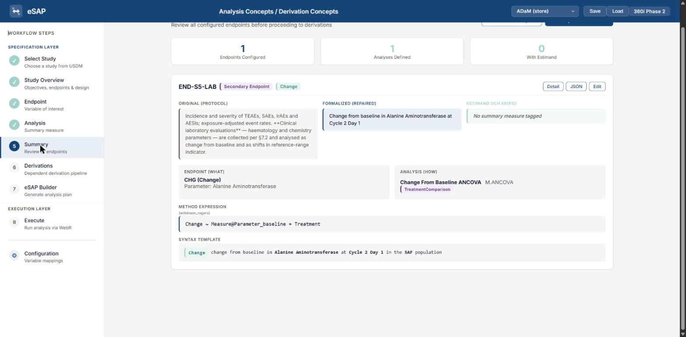

## 6. Derivations — how the number is made

A pipeline graph. `T.ChangeFromBaseline` has already been chosen for `CHG`: it is the only
template that produces a `Change`, so the app selects it without asking. Three measure slots
show ● — minuend, subtrahend, covariate.

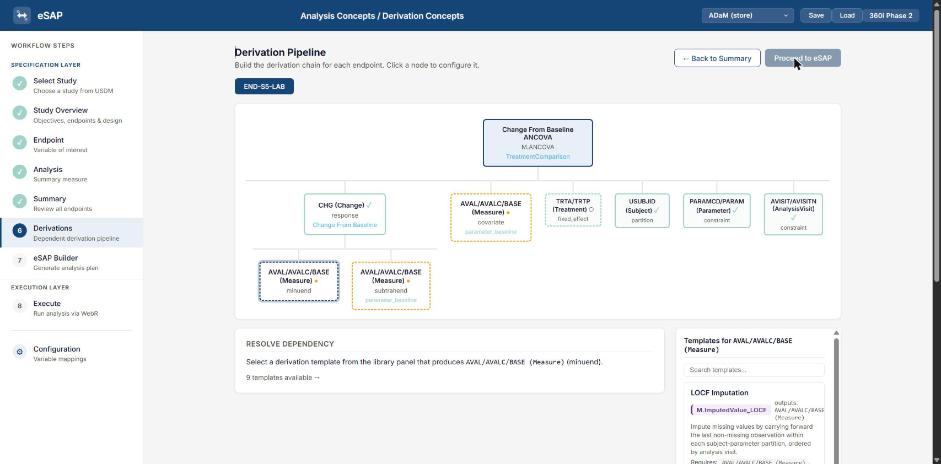

Click each, and in the panel on the right scroll to the **bottom** of the nine templates and
pick **`AVAL/AVALC/BASE (Measure) (raw)` — Use source data directly**. The nine above it are
derivations, and none of them is what a collected value needs (lab log L2).

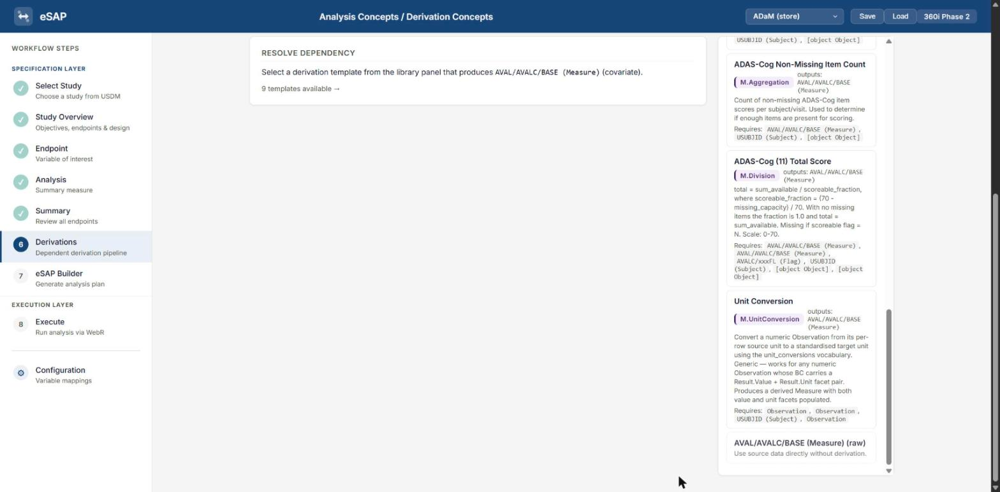

Click the **TRTA/TRTP (Treatment)** node and **Confirm**.

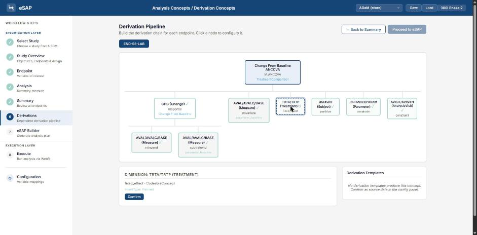

**Link the BC.** Click each of the three measure nodes again; a list of the study's eight
Biomedical Concepts appears. Tick **ALT Alanine Aminotransferase** on each. The picker offers
all eight regardless of which the endpoint names (lab log L5).

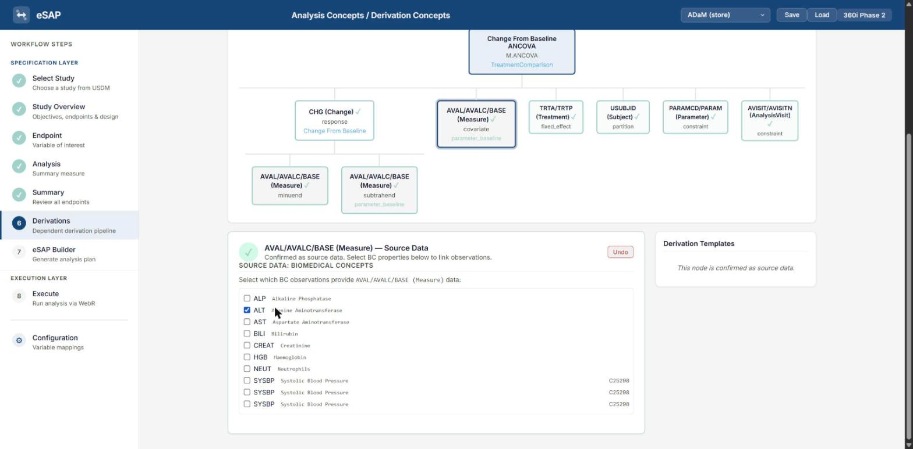

Every node now shows ✓ and the banner reads *Pipeline Complete*, with the execution order
beneath it. Click **Save** in the header if you want the chain as a file — it is what
`chain.json` is.

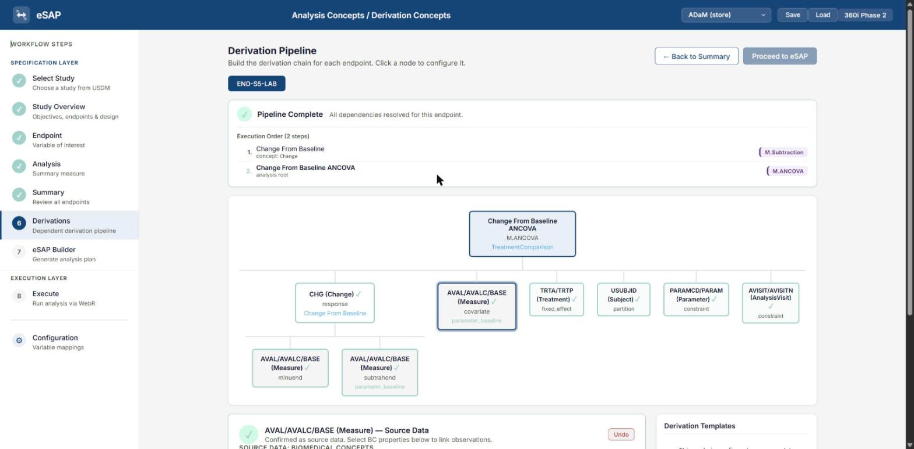

## 7. eSAP Builder

Five tabs: SAP Document, ADaM Datasets, ADaM Spec, JSON, Define-XML. In the SAP Document,
§5.1.1.2 *Main Analytical Approach* shows END-S5-LAB with *1 analysis*. In the JSON tab, read
the estimand knowing where each field came from: `analysisPopulation` and `interventions` are
the chain's dimension values (lab log L6); `populationSummary` and `intercurrentEvents` are the
study's own estimand E6, which is why step 1's card had to be clicked. The study block below
them should name TORIVA-LUNG 301.

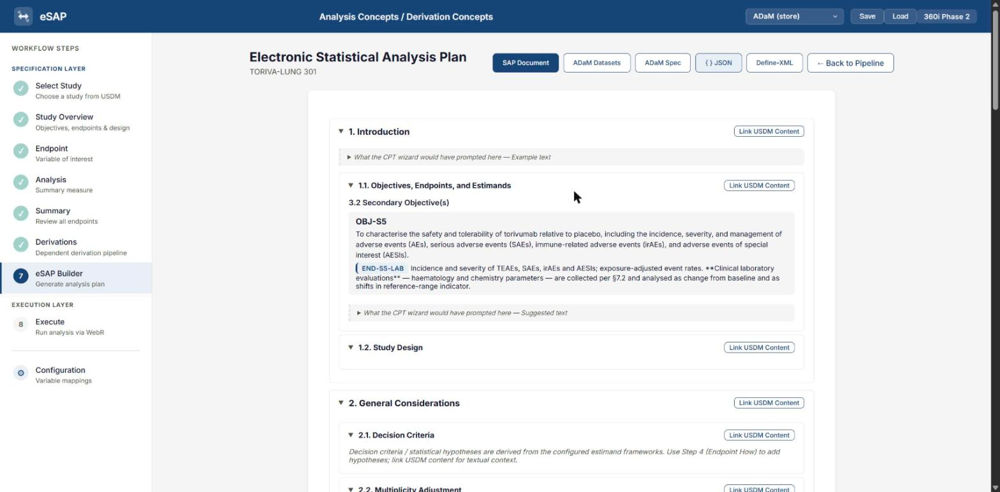

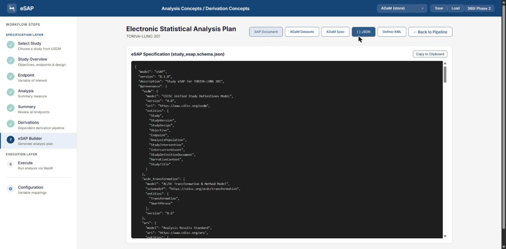

## 8. Execute

::: warn The one setting that fails the run if you miss it
Before you press Execute, the **Treatment** row of the *Resolved slices* table must have its
value set to **(no filter — keep all values)** — item 5 below, last row. Left at the step-3
label, the engine partially matches it to one arm and the run stops with *"contrasts can be
applied only to factors with 2 or more levels"*. The console shows it before the error does:
a `Filter: TRT01P ~ …  (partial match)` line that drops 429 rows to 287, and then
`factor(): TRT01P → 1 levels`. Everything else can be right and this alone fails it.
:::

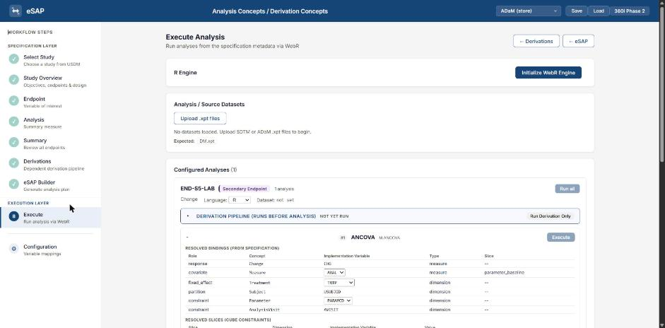

1. **Initialize WebR Engine.** About thirty seconds; the page may freeze while it installs
   `haven`.
2. **Upload .xpt files** — `adsl.xpt` and `adlb.xpt`. The 45 MB file takes ten to twenty
   seconds and the page freezes again.
3. **Source dataset:** `adlb`.
4. In the **Resolved bindings** table (the upper one), two dropdowns in the *Implementation
   Variable* column:
   - row **covariate / Measure**: change `AVAL` to **`BASE`**. The default `AVAL` is the C2D1
     value — the response's own minuend — and the run completes without complaint on it.
   - row **fixed_effect / Treatment**: change `TRTP` to **`TRT01P`**.
5. In the **Resolved slices** table (the lower one):
   - row **endpoint / Population**: variable `ITTFL` → **`SAFFL`**, value `SAF` → **`Y`** (the
     default matches nothing).
   - row **endpoint / AnalysisVisit**: value → **`C2D1`**, from the data's list. The step-3 value,
     *Cycle 2 Day 1*, is the protocol's label and matches no row; the console log would show
     `Filter: AnalysisVisit == Cycle 2 Day 1 → 0 rows`.
   - row **endpoint / Visit**: value → **`C2D1`**. This is the *collected* visit (`VISIT`) beside the
     analysis visit (`AVISIT`) the endpoint already carries. The recorded run had both. Without it
     the cube keeps seven unscheduled draws that the SAP's visit windows assign to C2D1, and the
     answer is 1.585 (SE 2.194) on 434 rows instead of the number below.
   - row **endpoint / Treatment**: variable → **`TRT01P`**, value → **`(no filter — keep all
     values)`**, the first entry in the dropdown. The step-3 value is a contrast label, not a data
     value; any of the app's own three entries keeps one arm and the run fails with *"contrasts
     can be applied only to factors with 2 or more levels"*. The engine treats an empty value as
     no filter, and that entry sets one.


6. **Execute.** About twenty seconds. The console log in the result should show four `Filter:`
   lines — Parameter, `SAFFL == Y`, `Visit == C2D1`, `AnalysisVisit == C2D1` — and no Treatment
   line; 429 rows in the cube, 427 in the model. The result: contrasts, LS means, type-3 tests,
   fit statistics. The engine reports the contrast as placebo minus torivumab, so it shows
   **+1.276**; the *torivumab minus placebo* below is the same number with the sign reversed.

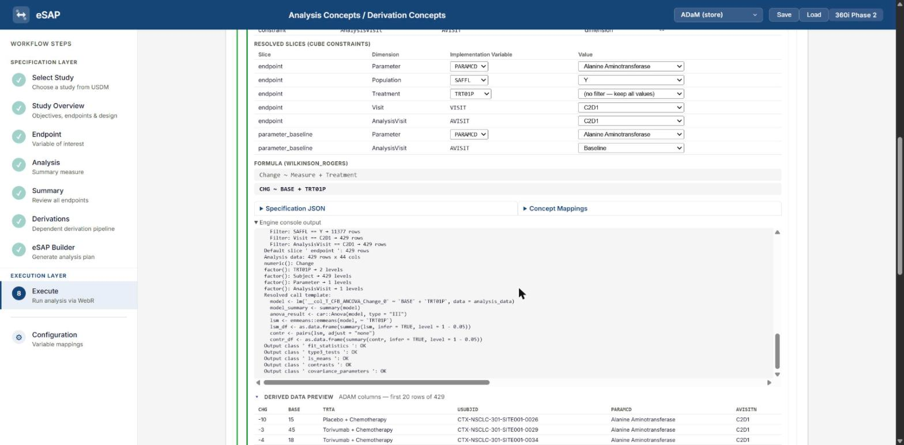

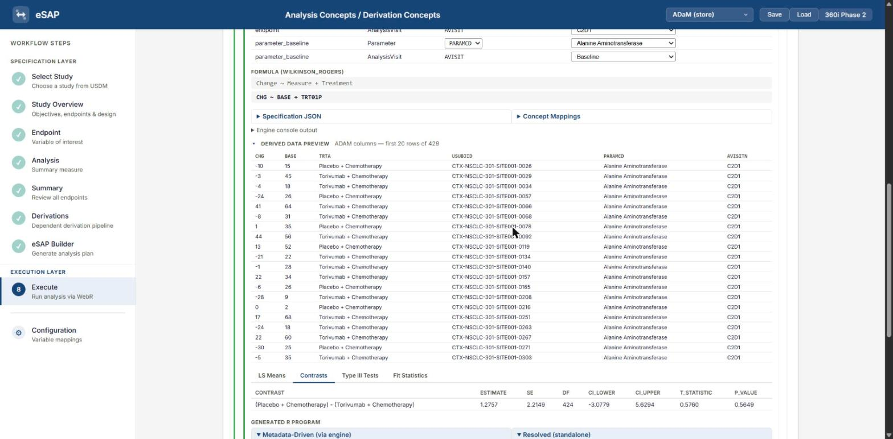

::: note The *(no filter)* entry is not the app's
The upstream page offers no way to clear a slice; the walkthrough server adds the option to
every slice-value dropdown when it serves the page (an overlay script; the submodule is
untouched). If you serve the app any other way, the equivalent is the browser console:
`const r = window.appState.endpointResults.Endpoint_SAFETY_LAB; r.sliceOverrides = r.sliceOverrides || {}; r.sliceOverrides['endpoint|Treatment'] = { variable: 'TRT01P', value: '' };`
:::

::: result
On the data regenerated under #27: Torivumab − Placebo on ALT change from baseline at C2D1 =
**−1.276 (SE 2.215, n = 429)**.

Compare it with `endpoints/01-simple-lab-cfb/comparison.md`, section *At `a806630`*: the same
model on TORIVA's own `CHG`, `BASE` and `ANL01FL` gives **−1.305 (SE 1.607)**, and the
difference is the baseline row the engine picks — first row in the Baseline window rather than
the `ABLFL` row — for 72% of subjects.
:::

## The second pass: vital signs by MMRM

Same steps, with these differences:

- Step 2: tick **END-S5-VS**. Step 3: Parameter `Systolic Blood Pressure`; tick **MMRM
  method**; leave AnalysisVisit's value **blank** — MMRM takes every visit. Step 4: **Change
  From Baseline MMRM Primary Analysis**. Step 6: link **SYSBP** on the three measure nodes.
- Data: convert `advs.parquet`, restricted to `AVISIT` in Baseline, C2D1 … C6D1 — an
  unstructured covariance over forty visits is not a fit anyone runs, and the cube's visit
  dimension cannot express a set.
- Upstream ships no R implementation for `M.MMRM`; the one this project wrote is
  `endpoints/04-vitals-cfb-mmrm/r_impl_mmrm.json`. **Served by the walkthrough server, it is
  registered for you**: a status box at the bottom right says *M.MMRM implementation registered*
  when the app loads, and *mmrm package installed* about half a minute after you initialise the
  WebR engine (the engine does not act on an implementation's `packages` list, so the overlay
  runs `webr::install("mmrm")` for you). Wait for the second message before Execute.

::: note Served any other way
The two console lines are
`window.appState.methodImplementationCatalog.implementations['M.MMRM'] = [await (await fetch('/ac-dc-app/data/toriva/r_impl_mmrm.json')).json()]`
and, after the engine is initialised,
`await (await import('/ac-dc-app/js/utils/webr-engine.js')).executeR('webr::install("mmrm")')`.
:::

Then Execute; the fit takes one to two minutes and the page freezes while it runs.

::: result
Expect **−4.44 (SE 1.91)** at C2D1 (torivumab − placebo) against a reference of −1.80 on the
data at `a806630`, over five visits.
:::

## What to notice

Sixteen decisions in the second pass, none of them statistical, ten of them repeats. The
number comes out; the reason it differs from the trial's own is the same on both endpoints, and
it survived a regeneration of the data: new numbers, the same 70-odd per cent of subjects with a
different baseline row. That is the thing the whole traverse exists to show, and it is more
convincing when the click that causes it is your own.

::: details The runs that shaped this page

Kept here rather than in the steps, because the page is for driving the app and the record is
for knowing why it says what it says.

- **2026-09-19** — written from the first pass on both endpoints. The dimension-form rule at
  step 3 was learned at step 8, after two failed runs; the covariate default (`AVAL`) was run 3 of
  that pass, fitted on the response's own minuend.
- **2026-09-20** — revised after TORIVA issues #27 and #53 changed the source and its data
  (P7). Before #27 the lab result was −1.830 (SE 1.768, n = 432) against a reference of −0.893,
  with 70% of subjects on a different baseline row; the MMRM was +1.38 against +1.95, and the
  window included a C1D15 visit the protocol never scheduled (D17). The `walkthrough.py serve`
  command was added the same day; its first version launched upstream's `serve.py` and dropped
  fetches on load. Until this date the fragment's concept references carried a relative path
  copied from the pilot, which landed on the server's 404 page.
- **2026-09-22** — the recording made, on the data at `a806630`. LG's run came out at 1.585:
  the guide had promised a number without naming the Visit slice that produces it, so the Visit
  row was added. The guide had also said "leave the value blank" for Treatment, written from an
  automated run that set the state directly; there was no blank to leave. The console line was
  the fix for a day, and the *(no filter)* overlay replaced it the same evening.
- **2026-09-23** — the Reference tab had shown raw JSON (LG: *not pretty*); the server now
  renders it as a page. Confirmed on the page, after LG asked, that the Parameter box can stay
  unticked. The *two names for one visit* note added after LG found the dropdown had no `C2D1`.
- **2026-09-29** — restructured for layout, text kept.
- **2026-10-01** — LG drove the lab endpoint through by hand and got 1.276. The composed phrase
  at step 3, until then quoted from memory with the visit in the wrong place, was replaced by
  the one the page composed. The Treatment slice warning at step 8 was raised to the top of the
  step after it failed the run.
- **2026-10-02** — the lab eSAP was found to have been generated with the Pilot's definition
  active (lab log L6), which is why step 1 now says to click the card before loading a chain.
:::
